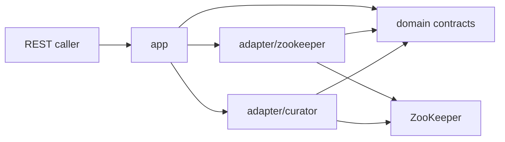

# Current architecture

Spring Boot selects one adapter per process. Acquire reserves the resource key in the controller, resolves version metadata in ZooKeeper and asks the adapter for the lock. On success the controller keeps the handle in memory. Release routes to that same service process and clears the handle after the adapter returns successfully.

The raw adapter holds ephemeral sequential znodes on its ZooKeeper session. Curator uses its own lock recipe and a thread-owned handle, so acquire and release belong to the same Java thread. Each provider uses a separate root by default. Two REST processes share ZooKeeper and each maintains its own handle registry.

The initial milestones cover reproducible packaging, then lease ownership, session failure, fencing and online rotation. The baseline retains the starting revision for protocol comparisons. [Initial baseline](baseline.md)
